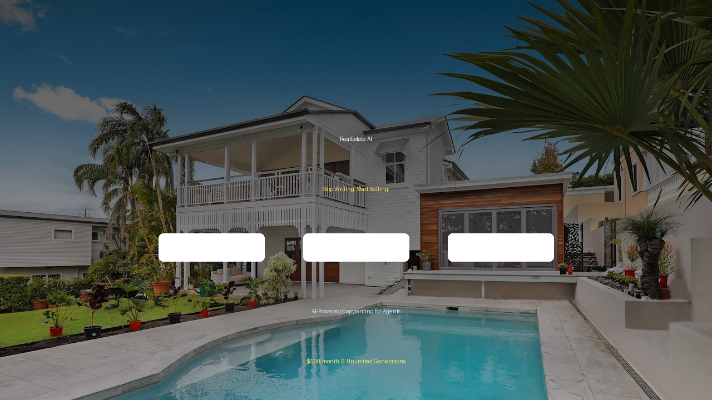

# RealEstate AI Copywriter

An AI-powered SaaS web app that helps real estate agents turn basic property details into marketing content in seconds: a professional listing description, an Instagram caption and an email blast for buyers.



## Features

- **AI content generation:** Enter the address, property type, beds, baths, square feet and price, and get three ready-to-use pieces of content from OpenAI GPT-4o.
- **User accounts:** Sign up, log in and log out with session-based authentication.
- **Paid subscription:** Gumroad checkout with a webhook that activates the user's account automatically after purchase.
- **Dashboard:** View your 10 most recent generations.
- **Landing and pricing pages:** A clear product page with an example of the output.

## Tech Stack

| Area | Tools |
| --- | --- |
| Backend | Python, Flask |
| Database | SQLite |
| AI | OpenAI API (GPT-4o) |
| Payments | Gumroad |
| Frontend | HTML, CSS, Jinja templates |
| Deployment | Gunicorn (`Procfile` included) |

## Getting Started

1. Clone the repository and install the dependencies:

   ```bash
   git clone https://github.com/tejas28022009-oss/-realestate-ai.git
   cd -realestate-ai
   pip install -r requirements.txt
   ```

2. Create a `.env` file in the project folder:

   ```
   SECRET_KEY=your-secret-key
   OPENAI_API_KEY=your-openai-api-key
   GUMROAD_URL=your-gumroad-product-url
   GUMROAD_WEBHOOK_SECRET=a-long-random-string
   ```

   Set your Gumroad ping URL to `https://your-domain/gumroad-webhook/<GUMROAD_WEBHOOK_SECRET>`.

3. Run the app:

   ```bash
   python app.py
   ```

4. Open `http://localhost:5000` in your browser.

## Project Structure

```
app.py            Flask app: routes, database, AI generation, payment webhook
templates/        Landing, login, pricing and dashboard pages
static/           Styles and images
Procfile          Gunicorn start command for deployment
```

## Author

Built by [Tejas B. Patole](https://github.com/tejas28022009-oss).
